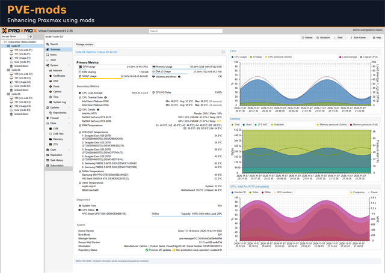

# PVE-mods
PVE-mods is a Debian package that extends the Proxmox Virtual Environment (PVE) web interface with mods. Mods are enabled and configured through the interactive `pve-mods-configure` wizard.

<p align="center">
  <a href="images/proxmox-node-overview.png">
    
  </a>
  <br>
  <em>Click the image to view it in full size.</em>
</p>

Compatibility: PVE 9.0+

All commands in this document (install, configure, upgrade, uninstall) must be run as `root` on the Proxmox VE host.

## Table of contents

- [Available mods](#available-mods)
- [How it works](#how-it-works)
- [Install](#install)
  - [Migrating from v1 (legacy scripts)](#migrating-from-v1-legacy-scripts)
  - [Manual configuration changes](#manual-configuration-changes)
  - [Re-applying patches after PVE upgrades](#re-applying-patches-after-pve-upgrades)
- [Upgrade](#upgrade)
- [Uninstall](#uninstall)
- [Notes](#notes)
  - [Reverse proxy / CDN caching](#reverse-proxy--cdn-caching)
- [Support and contributing](#support-and-contributing)
  - [Donations](#donations)
- [License](#license)

> Looking for the old standalone bash scripts (v1)? They are archived, see the [legacy scripts readme](https://github.com/Meliox/PVE-mods/blob/e1c3eb0524fbb8ca940454aef3a51c0644a2d170/legacy-scripts/readme.md).

### Available mods

Each mod is optional and enabled individually in `pve-mods-configure`. See the mod readmes for details and screenshots.

| Mod | Description |
|-----|-------------|
| [`node_info`](src/modules/node_info/readme.md) | Adds live hardware data to the node summary panel: CPU/NVMe/HDD/SSD/RAM temperatures, fan speeds, GPU stats and history graphs (Intel/NVIDIA), UPS status, ZFS/SMART storage health and system/motherboard info. Data is collected by a background daemon. |
| [`nag_screen`](src/modules/nag_screen/readme.md) | Removes the subscription nag screen from the PVE web UI. |
| [`oidc_console_access`](src/modules/oidc_console_access/readme.md) | Allows selected Proxmox groups, including OIDC-synced groups, to use the node Upgrade console and/or passwordless root Shell. |

Some mods need additional packages on the host. Required tools are listed in each mod's readme (for example [`node_info` requirements](src/modules/node_info/readme.md#requirements)).

### How it works

1. The `pve-mods` package installs the patch files and scripts under `/usr/lib/pve-mods/`.
2. The main configuration file and per-mod settings are stored under `/etc/pve-mods/`.
3. Running `pve-mods-configure` prompts for which mods to enable and how to configure them.
4. The wizard applies the selected patches to the PVE system files and restarts `pveproxy`.
5. When upgrading `pve-mods`, the previous patches are reverted before package files are replaced, then the new version's patches are applied.
6. Optionally, patches are re-applied automatically after a `pve-manager` upgrade (see [Re-applying patches after PVE upgrades](#re-applying-patches-after-pve-upgrades)).

### Install

1. Install `pve-mods`. The installer downloads the latest release, verifies its checksum and asks for confirmation:

   ```bash
   curl -sL https://raw.githubusercontent.com/Meliox/PVE-mods/refs/heads/main/install.sh | bash
   ```

2. Install the additional packages required by the mods you want to use - see each mod's readme linked in the [Available mods](#available-mods) section.
3. Run `pve-mods-configure` to enable/disable and configure mods.
4. Hard-refresh the browser (`Ctrl+F5`) so the patched web UI is loaded.

For multiple nodes, install `pve-mods` on all nodes with identical configuration.

#### Migrating from v1 (legacy scripts)

`pve-mods-configure` refuses to run if it detects a v1 script installation. Remove it first with the legacy script you installed, for example:

```bash
bash pve-mods-gui-sensors.sh uninstall
```

The scripts are available in [legacy-scripts/](legacy-scripts/readme.md).

#### Manual configuration changes
Configuration files are located in `/etc/pve-mods/`. After any manual edits, restart `pveproxy` to apply the changes:

```bash
systemctl restart pveproxy
```

#### Re-applying patches after PVE upgrades

Upgrading Proxmox packages (e.g. `pve-manager`) can overwrite the patched files and remove the mods. Enable the "Auto re-patch on PVE upgrade" option in `pve-mods-configure` to have `pve-mods` re-apply the enabled patches automatically after such upgrades. Otherwise, run `pve-mods-configure` again after a PVE upgrade.

If the patches of a mod are incompatible with the new PVE version, they are not applied: the mod is left unpatched (reverted to a clean state), a warning is printed, and the PVE upgrade itself is not blocked. Check for a newer `pve-mods` release that supports your PVE version, then run `pve-mods-configure` to apply the mod.

### Upgrade

`pve-mods` follows [Semantic Versioning](https://semver.org/), using `MAJOR.MINOR.PATCH` version numbers. Major releases may include breaking changes. Before upgrading to a new major version, read its release notes and changelog so you can review those changes and any required migration steps. Minor releases add backward-compatible functionality, and patch releases contain backward-compatible fixes.

To upgrade to the latest release, run the installer as `root`. It downloads and verifies the release package, then installs it over the current version; you do not need to uninstall first.

```bash
curl -sL https://github.com/Meliox/PVE-mods/releases/latest/download/install.sh | bash
```

### Uninstall

```bash
apt-get remove pve-mods
```

Removing the package reverts all applied patches and asks whether to keep `/etc/pve-mods/pve-mods.conf`. Use `apt-get purge pve-mods` to also delete all configuration and state (`/etc/pve-mods`, `/var/lib/pve-mods`).

Afterwards, remove the dependencies installed for the respective mods if no longer needed.

### Notes

#### Reverse proxy / CDN caching

If mod details appear when accessing a node directly but not through a reverse proxy or CDN, it may be serving a cached, unpatched `pvemanagerlib.js`. Its URL version may not change when the file is patched, so purge the cache for Proxmox JavaScript assets (such as `/pve2/js/`), disable asset caching for the PVE host, and hard-refresh the browser. After a Proxmox update, reapply the mod and purge the proxy/CDN cache again.

---

## Support and contributing

- Report bugs or request features through [GitHub issues](https://github.com/Meliox/PVE-mods/issues) (include your PVE and `pve-mods` versions).
- See [CONTRIBUTING.md](CONTRIBUTING.md) for how to contribute and run the tests.
- Report security vulnerabilities as described in [security.md](security.md).

### Donations

If you find this helpful, a small donation is appreciated:

Paypal: [](https://www.paypal.com/cgi-bin/webscr?cmd=_s-xclick&hosted_button_id=K8XPMSEBERH3W)

Bitcoin (BTC): `16hg7syEJ3HkSP1PAANkpSW6pZ4vCdvUnK`

## License

Released under the [MIT License](LICENSE).

