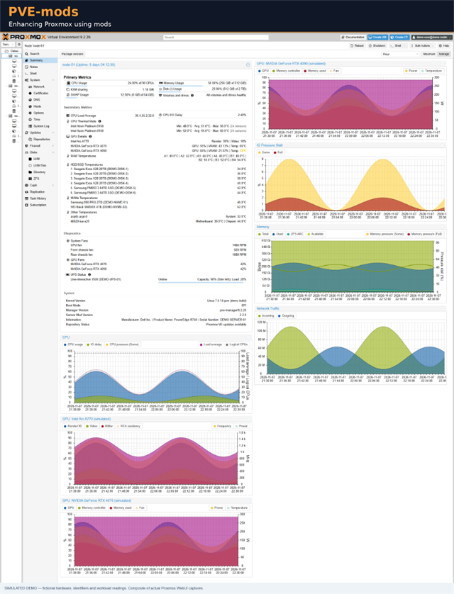

# PVE-mods

[](https://github.com/Meliox/PVE-mods/releases/latest)
[](https://github.com/Meliox/PVE-mods/blob/compatibility-data/report.md)
[](https://github.com/Meliox/PVE-mods/releases)

PVE-mods is a Debian package that extends the Proxmox Virtual Environment (PVE) web interface with mods. Mods are enabled and configured through the interactive `pve-mods-configure` wizard.


<p align="center">
  <a href="images/proxmox-node-overview.png">
    
  </a>
  <br>
  <em>Click the image to view it in full size.</em>
</p>

## Table of contents

- [Available mods](#available-mods)
- [How it works](#how-it-works)
- [Install](#install)
  - [Option A: APT repository](#option-a-apt-repository)
  - [Option B: Installer script](#option-b-installer-script)
  - [Migrating from v1 (legacy scripts)](#migrating-from-v1-legacy-scripts)
  - [Manual configuration changes](#manual-configuration-changes)
  - [Re-applying patches after PVE upgrades](#re-applying-patches-after-pve-upgrades)
- [Upgrade](#upgrade)
  - [Testing channel](#testing-channel)
  - [Installing an older version](#installing-an-older-version)
  - [Changelogs](#changelogs)
- [Uninstall](#uninstall)
- [Notes](#notes)
  - [A mod cannot be installed or upgraded](#a-mod-cannot-be-installed-or-upgraded)
  - [Reverse proxy / CDN caching](#reverse-proxy--cdn-caching)
- [Support and contributing](#support-and-contributing)
  - [Donations](#donations)
- [License](#license)

> Looking for the old standalone bash scripts (v1)? They are archived, see the [legacy scripts readme](https://github.com/Meliox/PVE-mods/blob/e1c3eb0524fbb8ca940454aef3a51c0644a2d170/legacy-scripts/readme.md).

## Available mods

PVE-mods ships with a collection of mods, each of which is optional and is enabled and configured individually through `pve-mods-configure`. The table below summarizes what each mod does; see the linked mod readmes for full details, configuration options and screenshots.

**Compatibility:** Development targets the latest Proxmox VE release. Every mod's patches are verified daily against the newest packages from the `pve-no-subscription` repository, and the badges below reflect the latest results: the status badge indicates whether the mod currently applies cleanly, and the package badges show the most recent version of each patched Proxmox package the mod is confirmed to work with. The full history, including failure details and test logs, is available in the [compatibility report](https://github.com/Meliox/PVE-mods/blob/compatibility-data/report.md).

| Mod | Description | Daily mods test |
|-----|-------------|------------------|
| [`node_info`](src/modules/node_info/readme.md) | Adds live hardware data to the node summary panel: CPU/NVMe/HDD/SSD/RAM temperatures, fan speeds, GPU stats and history graphs (Intel/NVIDIA/AMD), UPS status, ZFS/SMART storage health and system/motherboard info. Data is collected by a background daemon. | [](https://github.com/Meliox/PVE-mods/blob/compatibility-data/report.md)<br> |
| [`nag_screen`](src/modules/nag_screen/readme.md) | Removes the subscription nag screen from the PVE web UI, including the mobile UI. | [](https://github.com/Meliox/PVE-mods/blob/compatibility-data/report.md)<br><br><br> |
| [`oidc_console_access`](src/modules/oidc_console_access/readme.md) | Allows selected Proxmox groups, including OIDC-synced groups, to use the node Upgrade console and/or passwordless root Shell. | [](https://github.com/Meliox/PVE-mods/blob/compatibility-data/report.md)<br> |
| [`guest_summary`](src/modules/guest_summary/readme.md) | Merges the VM and LXC summary graphs into five charts: CPU and memory with Some/Full pressure, plus network, disk IO and IO pressure stall. | [](https://github.com/Meliox/PVE-mods/blob/compatibility-data/report.md)<br> |
| [`node_search`](src/modules/node_search/readme.md) | Adds guest IP/MAC addresses, hostname and OS to the resource lists and global Search, with address search, numeric IP sorting and result counts. | [](https://github.com/Meliox/PVE-mods/blob/compatibility-data/report.md)<br> |

A *failing* badge means the mod's patches no longer apply to the newest Proxmox packages; the fix is tracked in an open [patch-break issue](https://github.com/Meliox/PVE-mods/issues?q=is%3Aissue+is%3Aopen+label%3Apatch-break). The package badges keep showing the latest *working* versions, with an orange badge marking the package whose newer upstream version likely caused the break. An *unavailable* badge means the last test run could not complete (for example a repository outage), not that the mod is broken.

Some mods need additional packages on the host. Required tools are listed in each mod's readme (for example [`node_info` requirements](src/modules/node_info/readme.md#requirements)).

## How it works

1. The `pve-mods` package installs the patch files and scripts under `/usr/lib/pve-mods/`.
2. The main configuration file and per-mod settings are stored under `/etc/pve-mods/`.
3. Running `pve-mods-configure` prompts for which mods to enable and how to configure them.
4. The wizard applies the selected patches to the PVE system files and gracefully reloads `pveproxy`.
5. When upgrading `pve-mods`, the previous patches are reverted before package files are replaced, then the new version's patches are applied.
6. Optionally, patches are re-applied automatically after a `pve-manager` upgrade (see [Re-applying patches after PVE upgrades](#re-applying-patches-after-pve-upgrades)).

All commands in this document (install, configure, upgrade, uninstall) must be run as `root` on the Proxmox VE host.

## Install

1. Install `pve-mods` with one of the two options below.
2. Install the additional packages required by the mods you want to use - see each mod's readme linked in the [Available mods](#available-mods) section.
3. Run `pve-mods-configure` to enable/disable and configure mods.
4. Hard-refresh the browser (`Ctrl+F5`) so the patched web UI is loaded.

For multiple nodes, install `pve-mods` on all nodes with identical configuration.

### Option A: APT repository

Adding the signed PVE-mods APT repository lets `apt` install and upgrade `pve-mods` together with the rest of the system. The `trixie` suite targets Proxmox VE 9 and contains published stable releases:

```bash
install -d -m 0755 /etc/apt/keyrings
curl -fsSL https://pve-mods-apt.meliox.workers.dev/pve-mods.gpg \
  -o /etc/apt/keyrings/pve-mods.gpg
chmod 0644 /etc/apt/keyrings/pve-mods.gpg

cat > /etc/apt/sources.list.d/pve-mods.sources <<'EOF'
Types: deb
URIs: https://pve-mods-apt.meliox.workers.dev
Suites: trixie
Components: main
Signed-By: /etc/apt/keyrings/pve-mods.gpg
EOF

apt update
apt install pve-mods
```

The signing key is downloaded over HTTPS. To verify it, compare its fingerprint with the maintainer's signing key from an independent trusted source:

```bash
gpg --show-keys --with-fingerprint /etc/apt/keyrings/pve-mods.gpg
```

The repository metadata is signed, so `apt` verifies the package indexes and the checksums of downloaded packages. The package is architecture-independent but the repository only publishes the `amd64` index.

### Option B: Installer script

The installer downloads the latest release, verifies its checksum and asks for confirmation. It does not add the APT repository, so later upgrades are done by running it again:

```bash
curl -sL https://raw.githubusercontent.com/Meliox/PVE-mods/refs/heads/main/install.sh | bash
```

To switch to the APT repository later, follow [Option A](#option-a-apt-repository); the package is the same, so you do not need to uninstall first.

### Migrating from v1 (legacy scripts)

`pve-mods-configure` refuses to run if it detects a v1 script installation. Remove it first with the legacy script you installed, for example:

```bash
bash pve-mod-gui-sensors.sh uninstall
```

The scripts are available in [legacy-scripts/](legacy-scripts/readme.md).

### Manual configuration changes

Configuration files are located in `/etc/pve-mods/`. After any manual edits, gracefully reload `pveproxy` to apply the changes:

```bash
systemctl reload-or-try-restart pveproxy
```

### Re-applying patches after PVE upgrades

Upgrading Proxmox packages (e.g. `pve-manager`) can overwrite the patched files and remove the mods. Enable the "Auto re-patch on PVE upgrade" option in `pve-mods-configure` to have `pve-mods` re-apply the enabled patches automatically after such upgrades. Otherwise, run `pve-mods-configure` again after a PVE upgrade.

If the patches of a mod are incompatible with the new PVE version, they are not applied: the mod is left unpatched (reverted to a clean state), a warning is printed, and the PVE upgrade itself is not blocked. See [A mod cannot be installed or upgraded](#a-mod-cannot-be-installed-or-upgraded).

## Upgrade

`pve-mods` follows [Semantic Versioning](https://semver.org/), using `MAJOR.MINOR.PATCH` version numbers. Major releases may include breaking changes. Before upgrading to a new major version, read its release notes and changelog so you can review those changes and any required migration steps. Minor releases add backward-compatible functionality, and patch releases contain backward-compatible fixes.

If you installed from the [APT repository](#option-a-apt-repository), `pve-mods` is upgraded with the rest of the system:

```bash
apt update
apt install --only-upgrade pve-mods
```

If you used the installer script, run it again. It downloads and verifies the release package, then installs it over the current version; you do not need to uninstall first.

```bash
curl -sL https://raw.githubusercontent.com/Meliox/PVE-mods/refs/heads/main/install.sh | bash
```

If a mod's patch no longer matches its file, the upgrade still completes and the mod is marked as incompatible and re-tested after later updates - see [A mod cannot be installed or upgraded](#a-mod-cannot-be-installed-or-upgraded).

### Testing channel

The testing channel contains published prereleases and is for trying changes before they reach stable. After installing the signing key as described in [Option A](#option-a-apt-repository), replace the stable source:

```bash
cat > /etc/apt/sources.list.d/pve-mods.sources <<'EOF'
Types: deb
URIs: https://pve-mods-apt.meliox.workers.dev
Suites: trixie-testing
Components: main
Signed-By: /etc/apt/keyrings/pve-mods.gpg
EOF

apt update
apt install pve-mods
```

A channel is empty until a matching release has been published. Switching back to stable does not downgrade an installed testing version.

### Installing an older version

The repository keeps the 100 newest published releases, stable and prereleases together. List the versions in your configured channel and install an exact one, for example 2.1.0:

```bash
apt update
apt-cache madison pve-mods
apt-get install --allow-downgrades pve-mods=2.1.0
```

Downgrades may be incompatible with your configuration or Proxmox version. A later upgrade selects the highest available version again.

### Changelogs

```bash
apt changelog pve-mods
apt changelog pve-mods=2.1.0
```

## Uninstall

```bash
apt-get remove pve-mods
```

Removing the package reverts all applied patches and preserves configuration without prompting.

To also delete all configuration and state (`/etc/pve-mods`, `/var/lib/pve-mods`), use:

```bash
apt-get purge pve-mods
```

Afterwards, remove the dependencies installed for the respective mods if no longer needed. If you added the APT repository, also remove its source and key:

```bash
rm /etc/apt/sources.list.d/pve-mods.sources /etc/apt/keyrings/pve-mods.gpg
apt update
```

## Notes

### A mod cannot be installed or upgraded

Mods work by patching Proxmox files. If a patch does not apply (when enabling a mod, after a Proxmox update, or during a `pve-mods` upgrade), either the file was changed by something other than `pve-mods` (another tweak script or a manual edit), or the patch is not compatible with the installed Proxmox version. The warning lists the affected file, the failing hunk and the package that owns the file.

A mod you enabled that cannot be applied is marked as incompatible (`2` in `/etc/pve-mods/pve-mods.conf`; `0` is disabled, `1` is enabled) and shown as such in `pve-mods-configure`. It is re-tested after every `pve-mods` upgrade and, with auto re-patching enabled, after every Proxmox update, and it is enabled again automatically once its patches apply. Nothing is left half-patched meanwhile.

To fix it sooner:

1. Check whether the file is modified. If another tool re-edits it (for example a post-install hook in `/etc/apt/apt.conf.d/` that patches `proxmoxlib.js` after every `dpkg` run), disable that tool first. It would otherwise change the file again right after the next step.
2. Restore the original file by reinstalling the package that owns it, as named in the warning (`dpkg -S <file>` shows the owner), for example:

   ```bash
   apt reinstall proxmox-widget-toolkit
   ```

3. Select the mod in `pve-mods-configure` and choose to retry it. Choose to disable it instead to stop the retries.

If the patch still fails on a freshly reinstalled file, it is not compatible with the installed Proxmox version yet. Check the daily [compatibility report](https://github.com/Meliox/PVE-mods/blob/compatibility-data/report.md) for the mod's status and the last known-good package versions, check for a newer `pve-mods` release, or report it through a [GitHub issue](https://github.com/Meliox/PVE-mods/issues) with your PVE and `pve-mods` versions.

### Reverse proxy / CDN caching

If mod details appear when accessing a node directly but not through a reverse proxy or CDN, it may be serving a cached, unpatched `pvemanagerlib.js`. Its URL version may not change when the file is patched, so purge the cache for Proxmox JavaScript assets (such as `/pve2/js/`), disable asset caching for the PVE host, and hard-refresh the browser. After a Proxmox update, reapply the mod and purge the proxy/CDN cache again.

---

## Support and contributing

- Report bugs or request features through [GitHub issues](https://github.com/Meliox/PVE-mods/issues) (include your PVE and `pve-mods` versions).
- See [CONTRIBUTING.md](CONTRIBUTING.md) for how to contribute and run the tests.
- Report security vulnerabilities as described in [security.md](security.md).

### Donations

If you find this helpful, a small donation is appreciated:

PayPal: [](https://www.paypal.com/cgi-bin/webscr?cmd=_s-xclick&hosted_button_id=K8XPMSEBERH3W)

Bitcoin (BTC): `16hg7syEJ3HkSP1PAANkpSW6pZ4vCdvUnK`

## License

Released under the [MIT License](LICENSE).
