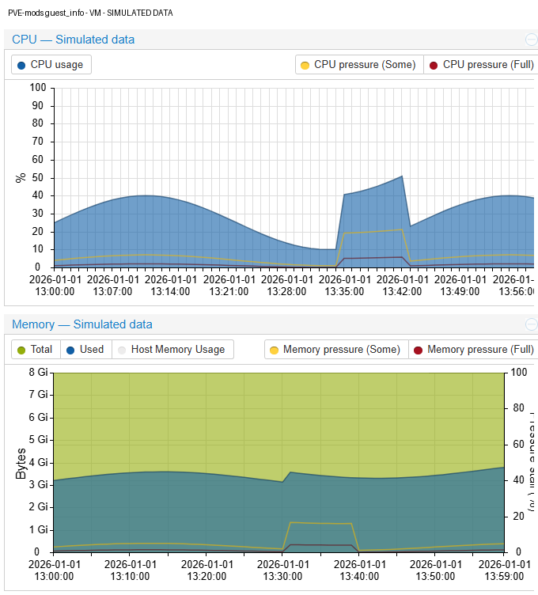
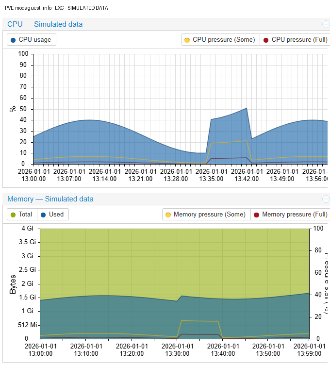

# guest_summary

Combines the VM and LXC summary graphs into five charts. Pressure data is shown next to the CPU and memory graphs it belongs to, instead of in separate graphs. Data comes from the existing guest `rrddata` endpoint, so no new collector, guest agent or RRD schema is needed.

## Table of contents

- [Features](#features)
- [Configuration](#configuration)

## Features

| Graph | Content |
|---|---|
| CPU | CPU usage plus Some/Full CPU pressure, in percent |
| Memory | Total/used memory in bytes (plus VM host memory); Some/Full memory pressure on a separate 0-100 % right axis |
| Network Traffic | Unchanged |
| Disk IO | Unchanged |
| IO Pressure Stall | Unchanged |

- The legends are clickable and sit below the title; pressure entries are grouped on the right.
- VM host-memory visibility keeps using the existing `pve-vm-hide-memhost` preference. Toggling pressure entries does not change it.
- Templates stay graph-free.
- Missing pressure data is never fabricated; its tooltip shows `No Data`. Which pressure metrics exist depends on Proxmox and the hardware.

### Virtual machine

### LXC container

The screenshots use simulated data.

## Configuration

The module has no settings. Enable or disable it with option **[5] Guest Summary** in `pve-mods-configure`, or set `guest_summary=1` under `[modules]` in `/etc/pve-mods/pve-mods.conf`. It is disabled by default and independent of `node_info`. Reload the browser without cache afterwards.
