# node_info

Extends the Proxmox VE node status view with live hardware sensor data. A background daemon collects data from the configured sources and exposes it through the PVE API.

<details>
<summary>Show a full node summary with all sensors and graphs enabled</summary>

<p align="center">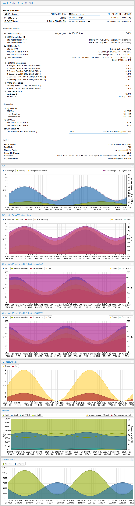</p>

</details>

## Table of contents

- [Features](#features)
  - [Temperature Sensors (lm-sensors)](#temperature-sensors-lm-sensors)
    - [CPU](#cpu)
    - [Memory](#memory)
    - [HDD/SSD and NVMe](#hddssd-and-nvme)
    - [Other](#other)
  - [Fan speeds](#fan-speeds)
  - [NVIDIA GPU](#nvidia-gpu)
  - [Intel GPU](#intel-gpu)
    - [Security concern: the `CAP_PERFMON` capability](#security-concern-the-cap_perfmon-capability)
  - [GPU summary and details](#gpu-summary-and-details)
  - [GPU graphs and history](#gpu-graphs-and-history)
  - [AMD GPU](#amd-gpu)
  - [UPS (Network UPS Tools)](#ups-network-ups-tools)
  - [CPU and memory graphs](#cpu-and-memory-graphs)
  - [System Information](#system-information)
  - [Storage health (ZFS and SMART)](#storage-health-zfs-and-smart)
- [Requirements](#requirements)
- [Debug Mode](#debug-mode)
  - [Per-collector debug files](#per-collector-debug-files)
  - [Verbose module logging (mod_debug)](#verbose-module-logging-mod_debug)


## Features

### Temperature Sensors (lm-sensors)

Reads hardware sensor data via `lm-sensors` and enriches each chip/adapter entry with context. CPU, RAM, HDD/SSD, NVME are directly supported and other temperature sensors can be bundled and displayed together.

#### CPU
The node summary shows one row per CPU package with the minimum, average and maximum temperature across its core sensors (or the package sensor when no per-core sensors exist) and the sensor count. Click the info icon on a row to open a live table of every sensor of that CPU.

<p align="center">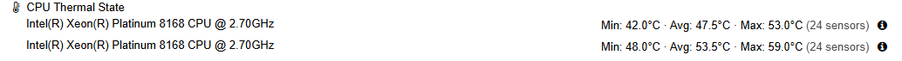</p>

<p align="center">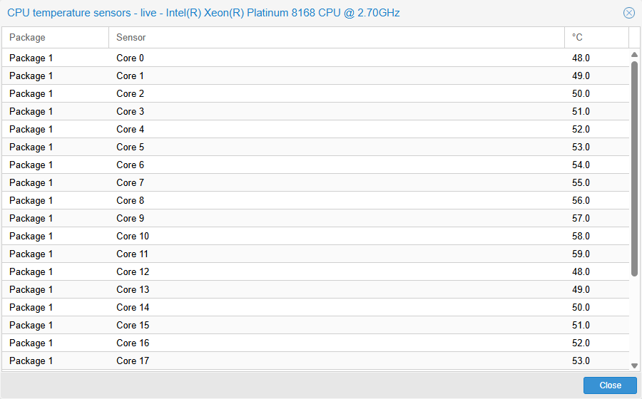</p>

<p align="center">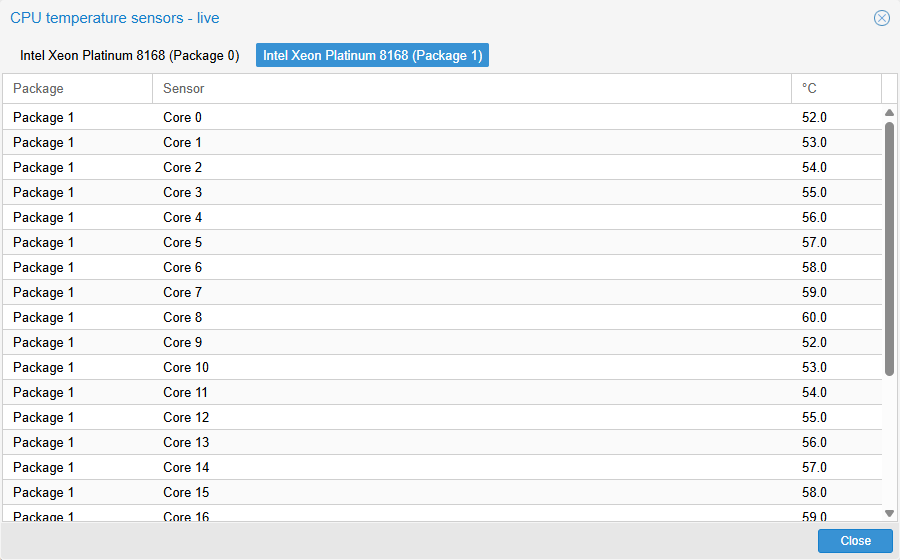</p>

#### Memory
RAM temperatures support both DDR5 (`spd5118`) and DDR3/4 (`jc42`/SODIMM) sensors, displayed per-DIMM with its slot number.
SODIMMs (DDR3/4) are normally detected automatically, including temperatures that a chip reports with a `SODIMM`/`DIMM` label (for example Dell's `dell_smm`). Such a temperature is shown with its sensor number as the slot, or the number after `DIMM` in its label. DDR5 may need the sensor to be exposed manually.

<p align="center">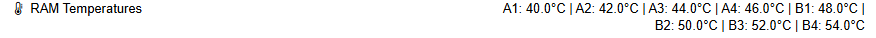</p>

Note: This is an example and you must replace registers with your findings.

1) Install the required package for investigation: ```apt-get install i2c-tools```
2) Load the modprobe modules: ```modprobe spd5118; modprobe i2c-dev```
3) Find the SMBus, by listing the available I²C/SMBus adapters: ```i2cdetect -l```
4) Look for the motherboard's SMBus, for example: ```i2c-0 smbus SMBus I801 adapter at 0000:00:1f.4```. Note the bus number ```0``` following "i2c-".
5) Scan the corresponding SMBus ```i2cdetect -y 0``` and note all addresses:
```
     0  1  2  3  4  5  6  7  8  9  a  b  c  d  e  f
00:                         08 -- -- -- -- -- -- --
10: -- -- -- -- -- -- -- -- -- -- -- -- -- -- -- --
20: -- -- -- -- -- -- -- -- -- -- -- -- -- -- -- --
30: -- -- -- -- -- -- -- -- -- -- -- -- -- -- -- --
40: -- -- -- -- 44 -- -- -- 48 -- -- -- -- -- -- --
50: 50 -- -- -- -- -- -- -- -- -- -- -- -- -- -- --
60: -- -- -- -- -- -- -- -- -- -- -- -- -- -- -- --
70: -- -- -- -- -- -- -- --
```
6) Investigate the register from the corresponding addresses, 5x are typically used by spd5118, e.g. `50` here.
7) Run ```i2cget -y 0 0x50 0x00 b```. This returns `0x51`. 51 identifies DDR5 SDRAM.
7) Manually instantiate the device: ```echo spd5118 0x50 > /sys/bus/i2c/devices/i2c-0/new_device```
8) Verify temperatures in sensors: ```sensors```:
```
spd5118-i2c-0-50 Adapter: SMBus I801 adapter at 0000:00:1f.4 temp1: +41.5°C (low = +0.0°C, high = +55.0°C) (crit low = +0.0°C, crit = +85.0°C)
```
9) Make it persistent at boot:
```
cat > /etc/modules-load.d/spd5118.conf <<'EOF'
spd5118
EOF
```
```
cat > /etc/udev/rules.d/99-spd5118.rules <<'EOF'
ACTION=="add", SUBSYSTEM=="i2c", KERNEL=="i2c-0", RUN+="/bin/sh -c 'echo spd5118 0x50 > /sys/bus/i2c/devices/i2c-0/new_device'"
EOF
```
10) Remove apt-get remove i2c-dev

To uninstall delete the module load and udev rule.

#### HDD/SSD and NVMe
Drives are listed with model and serial number.

<p align="center">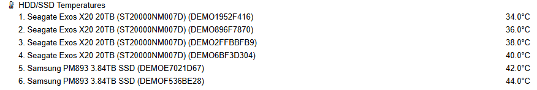</p>

<p align="center">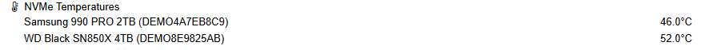</p>

#### Other
Remaining temperature sensors are grouped together.

<p align="center">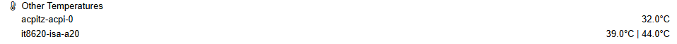</p>

### Fan speeds

Shows system fans (CPU, chassis) from `lm-sensors` and the fans of NVIDIA, AMD and Intel GPUs when available. Fans reporting zero speed can optionally be shown or hidden during `pve-mods-configure`.

<p align="center">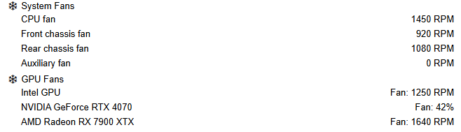</p>

### NVIDIA GPU

Polls `nvidia-smi` on a configurable interval. Supports multiple GPUs. Metrics can be stored in RRD for historical graphing (see [GPU graphs and history](#gpu-graphs-and-history)).

| Metric | Unit |
|--------|------|
| GPU temperature | °C |
| GPU utilisation | % |
| Memory utilisation | % |
| Memory used / total | MiB |
| Power draw / limit | W |
| Fan speed | % |

### Intel GPU

Polls `intel_gpu_top` for each detected Intel GPU card. Metrics can be stored in RRD for historical graphing (see [GPU graphs and history](#gpu-graphs-and-history)).

| Metric | Unit |
|--------|------|
| Requested / actual frequency | MHz |
| Interrupt rate | irq/s |
| RC6 residency | % |
| GPU power / package power | W |
| Engine busy/semaphore/wait (Render, Blitter, Video, VideoEnhance) | % |

#### Security concern: the `CAP_PERFMON` capability

`intel_gpu_top` needs the `CAP_PERFMON` capability to read the GPU's performance-monitoring counters. `pveproxy` — and therefore this mod's collector processes, which it forks — runs as the unprivileged `www-data` user, not root. Without `CAP_PERFMON`, `intel_gpu_top` fails with `Permission denied` and the Intel GPU collector produces no data.

To make Intel GPU monitoring work, `pve-mods-configure` checks whether `www-data` can already run `intel_gpu_top` and, **only with your explicit confirmation**, grants the capability directly to the binary:

```sh
setcap cap_perfmon+ep /usr/bin/intel_gpu_top
```

This is narrower than running as root or via `sudo`/setuid: it applies to this one binary only, and only grants the ability to read performance-monitoring counters — no write, filesystem, or other privileges are added. It is still a privilege increase for `www-data`, a network-facing service account, so weigh the trade-off before opting in:

- Decline the prompt (or leave Intel GPU monitoring disabled) to keep `www-data` at its default privilege level; the collector simply reports no Intel GPU data.
- The capability is removed automatically when the module is disabled or the package is uninstalled.

To remove it manually at any other time (e.g. without disabling the module):

```sh
setcap -r /usr/bin/intel_gpu_top
```

**Known limitation:** upgrading the `intel-gpu-tools` package replaces the `intel_gpu_top` binary, which resets the capability. This is not reapplied automatically. If GPU stats stop appearing after a package update, re-run `pve-mods-configure` (the collector also logs a warning to the journal when it can't collect data for this reason).

### GPU summary and details

The node summary has a *GPU Details* row with one line per detected Intel/NVIDIA/AMD GPU: Render and Video engine load for Intel, GPU load and VRAM usage for NVIDIA and AMD, plus the temperature when available. Values turn amber from 70 % and red from 90 %. Click the info icon on the row to open a live window with every reported value, with one tab per GPU.

<p align="center">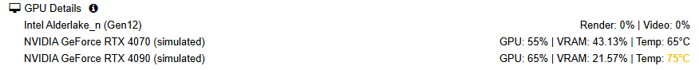</p>

<p align="center">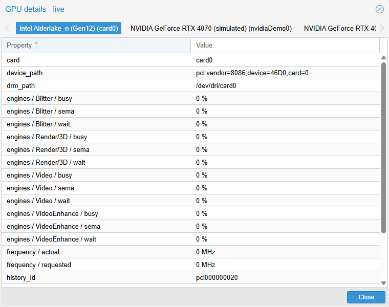</p>

<p align="center">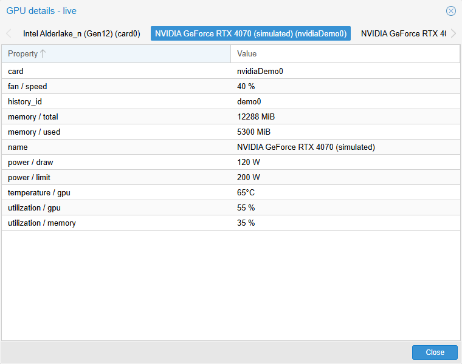</p>

### GPU graphs and history

The node summary page shows one graph per Intel/NVIDIA/AMD GPU that is reporting data. Utilisation metrics (%) are plotted on the left axis and can be shown or hidden through the left legend. The right axis shows one other unit at a time, such as frequency, power or temperature; click an entry in the right legend to switch between them.

<p align="center">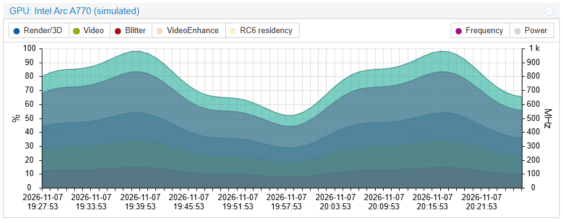</p>

<p align="center">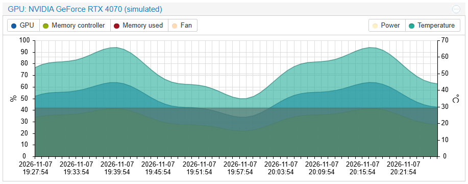</p>

`pve-mods-configure` asks how the graphs get their data (only when an Intel, NVIDIA or AMD GPU was detected):

| Mode | `gpu_history` | Behavior |
|------|---------------|----------|
| Live only (default) | `0` | Graphs fill from live samples while the page is open. |
| Record history | `1` | Samples are stored in RRD files, so past hours, days and years can be graphed. |

With history enabled the GPU collectors run around the clock, even when the web UI is closed, which uses CPU continuously. A `pve-mods-gpu-history.service` systemd unit keeps them running and is removed again when history or the module is disabled. If a GPU collector is not running, for example because the driver was not ready at boot, it is retried every 30 seconds.

RRD files are stored in `/var/lib/rrdcached/db/pve-mods-gpu/<node>/`, one per GPU and named after its PCI address (for example `pci000000020`), so a GPU keeps its history if `cardN` or the NVIDIA index changes.

### AMD GPU

Reads device and `amdgpu` hwmon sysfs files directly, so no ROCm or AMD-SMI is needed. The GPU must be bound to the host's `amdgpu` driver; GPUs passed through to a VM (for example bound to `vfio-pci`) cannot be monitored. Supports multiple GPUs, including APUs, and each device is identified by its PCI address. Metrics can be stored in RRD for historical graphing (see [GPU graphs and history](#gpu-graphs-and-history)).

`pve-mods-configure` detects AMD GPUs automatically and enables monitoring when one is found.

| Metric | Unit |
|--------|------|
| GPU utilisation | % |
| VRAM used / total | MiB |
| GTT used / total | MiB |
| Frequency | MHz |
| Sensor power | W |
| Temperatures (all sensors, with their labels and thresholds) | °C |
| Fan speed | RPM |

Notes:
- Only readings that the GPU exposes and that are valid are shown. A value of zero is a real reading; missing or invalid data is left out rather than shown as zero.
- Power is labelled *Sensor power* because the sensor can cover more than the GPU, for example the whole APU package.
- VRAM and GTT are shown separately. On an APU, VRAM can be a BIOS-reserved part of system memory rather than dedicated GPU memory. These are allocation figures, not memory-controller utilisation.
- The compact graph uses temperature, frequency, power and the first fan sensor where available. All sensors, including every frequency sensor label, are listed in the details window.
- Not covered yet: decoding of the binary `gpu_metrics` file, per-process and per-engine counters, and rediscovering GPUs while the collector is running.

<p align="center">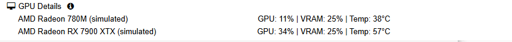</p>

<p align="center">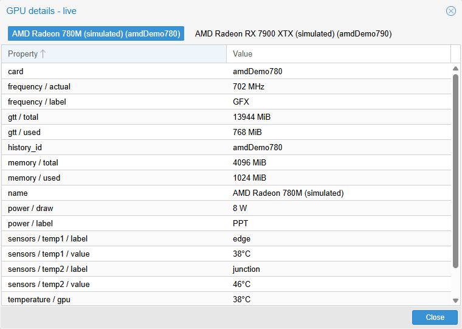</p>

<p align="center">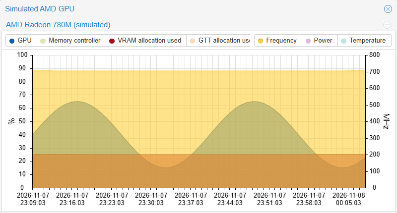</p>

<p align="center">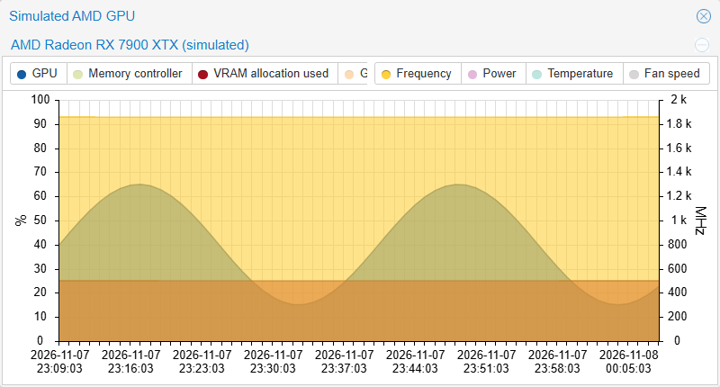</p>

The screenshots use simulated data.

### UPS (Network UPS Tools)

Polls `upsc` for a configured NUT device and exposes all key-value pairs returned by the daemon. Supports any UPS accessible via NUT (local or remote).

The node summary shows the UPS status, battery capacity with the runtime left, and load. Use the info button on the row to open a details window with the full device readings.

<p align="center">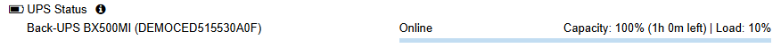</p>

<p align="center">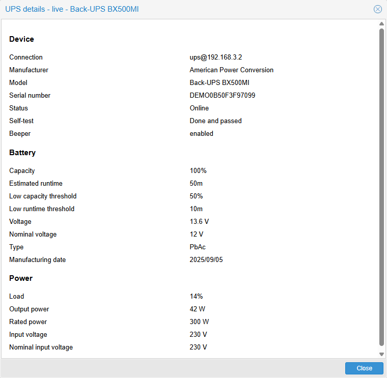</p>

Configuration: `device_name=ups@localhost`

### CPU and memory graphs

The node summary CPU and Memory graphs include the matching pressure stall (PSI) series instead of separate pressure graphs.

The CPU graph plots CPU usage, IO delay and CPU pressure (Some) on the left (%) axis. The right axis shows load average together with the number of logical CPUs (dashed line), so you can see at a glance when the load exceeds the available CPUs.

<p align="center">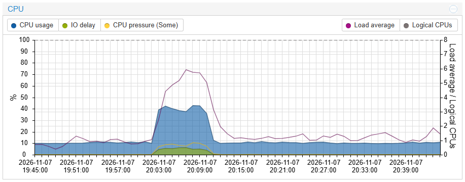</p>

The Memory graph shows memory usage on the left axis and memory pressure (Some and Full) on the right.


<p align="center">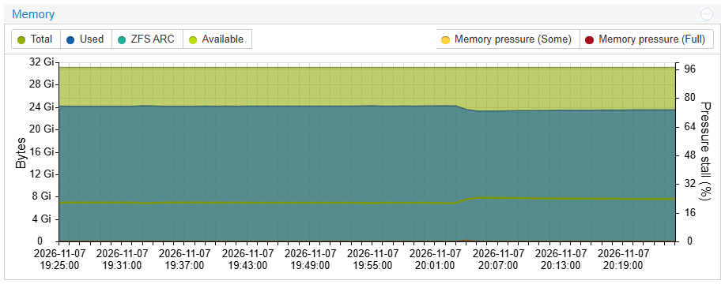</p>

### System Information

Reads hardware identity from `dmidecode` (cached at configure time, no runtime root required).

| `type` | Data source | Fields exposed |
|--------|-------------|----------------|
| `1` | DMI System | Manufacturer, Product Name, Serial Number |
| `2` | DMI Baseboard | Manufacturer, Product Name, Serial Number |

<p align="center">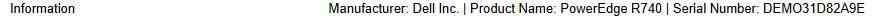</p>

### Storage health (ZFS and SMART)

Adds a **Volumes and drives** row to the node Summary: `OK`, or the highest-priority problem (e.g. `tank DEGRADED: drive removed`, `nvme6 life remaining: 7%`). Further problems are listed in the details window, opened with the info button next to the row. Disabled by default. Settings are in the `[storage_health]` section of `node_info.conf`.

<p align="center">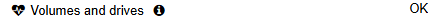</p>

<p align="center">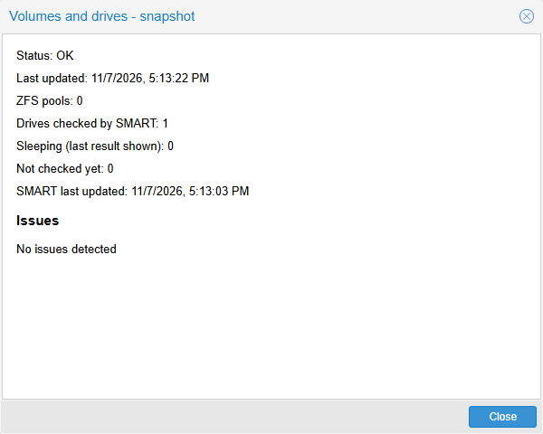</p>

Drives in standby are never woken by default (`smart_wake_disks=0`). SMART queries run from a small root service, `pve-mods-storage-smart.service`, which is installed and removed together with the setting. See the header of `Collector/StorageHealth.pm` for the checks, severities and design.

## Requirements

Each feature requires the corresponding tool to be installed on the Proxmox host:

| Feature | Required tool |
|---------|---------------|
| Temperature sensors | `lm-sensors` (`sensors` binary) |
| HDD/SSD temperatures | Kernel module `drivetemp` |
| NVIDIA GPU | `nvidia-smi` |
| Intel GPU | `intel-gpu-tools` (`intel_gpu_top` binary) |
| AMD GPU | None; the GPU must use the `amdgpu` kernel driver |
| UPS | `nut-client` (`upsc` binary) |
| Storage health | `zfsutils-linux` (`zpool`) for pools; `smartmontools` (`smartctl`) for drive health |
| System information | `dmidecode` (run once via `pve-mods-configure`) |

## Collector intervals

Collectors only run while something is reading the data: they start on a request and stop after `collector_timeout` seconds without one. The Proxmox web interface keeps them running, so the defaults suit normal use. Change them when:

- **An external client polls less often than the timeout.** Home Assistant or another tool reading the Proxmox API every 60 seconds finds the collectors stopped, and its temperature entities can become unknown or unavailable. Set `collector_timeout` above its polling interval, e.g. `120` for a 60 second poll.
- **You want less load.** A higher `data_pull` (e.g. `5`) polls the hardware less often, at the cost of less frequent updates.

| Option | Default | Purpose |
|--------|---------|---------|
| `data_pull` | `1` | Seconds between collector data polls. |
| `collector_timeout` | `10` | Seconds without a request before collectors stop. |

Set them in `/etc/pve-mods/conf.d/node_info.conf` or when running `pve-mods-configure` (current values are pre-filled), then restart `pveproxy`. Invalid values are ignored with a warning.

## Debug Mode

Each collector supports a debug mode that reads from a local file instead of executing the real tool. Useful for development and testing without physical hardware.

### Per-collector debug files

Set the collector's `_mode` flag to `1` in the `[debug]` section of `/etc/pve-mods/conf.d/node_info.conf` and populate its file(s) with sample data, captured from a real host via the commands below:

| Collector | Enable flag | File | Content | Example to generate it |
|-----------|-------------|------|---------|-------------------------|
| Temperature sensors | `lm_sensors_mode` | `lm_sensors_output_file` | Raw `sensors -J` JSON output | `sensors -J > /tmp/sensors-output.json` |
| Intel GPU | `intel_mode` | `intel_devices_file` | Device list, one line per GPU (`intel_gpu_top -L` format) | `intel_gpu_top -L > /tmp/intel-gpu-devices.json` |
| | | `intel_output_file` | Continuous `intel_gpu_top` JSON stats output | `intel_gpu_top -d /dev/dri/card0 -J -s 1000 > /tmp/intel-gpu-output.txt` |
| NVIDIA GPU | `nvidia_mode` | `nvidia_devices_file` | Device list CSV | `nvidia-smi --query-gpu=index,name,pci.bus_id --format=csv > /tmp/nvidia-smi-devices.csv` |
| | | `nvidia_output_file` | Stats CSV | `nvidia-smi --query-gpu=index,name,temperature.gpu,utilization.gpu,utilization.memory,memory.used,memory.total,power.draw,power.limit,fan.speed --format=csv,nounits > /tmp/nvidia-smi-output.csv` |
| AMD GPU | `amd_mode` | `amd_devices_file` | JSON array of devices, each with `card` (`amdN`), `name`, `history_id` (alphanumeric) and `sysfs_path` (absolute path of a fixture directory that mirrors the device's sysfs and hwmon files) | Not generated from a tool; write it by hand, or copy a real `/sys/class/drm/cardN/device` tree |
| UPS | `ups_mode` | `ups_output_file` | Raw `upsc` key: value output (despite the `.json` name, it's plain text, not JSON) | `upsc ups@192.168.1.50 > /tmp/ups-output.json` |
| Storage health | `storage_health_mode` | `zpool_output_file` | Raw `zpool status -LP` output | `zpool status -LP > /tmp/zpool-status.txt` |
| | | `smartctl_output_file` | `smartctl -a -j` JSON of one drive, or a JSON array of several (read directly by the collector; the SMART service is not used) | `smartctl -a -j /dev/sda > /tmp/smartctl-output.json` |

Fixture-based tests for the storage health parsers and evaluation run without any hardware: `bash build/test/test-storage-health.sh`. The AMD GPU collector, history, API, GUI and wizard tests also need no hardware: `bash build/test/test-amd.sh`. The Intel and NVIDIA GPU collector, history, API and GUI tests run the same way: `bash build/test/test-gpu.sh`. The lm-sensors collector (output sanitizing, DIMM/drive/CPU enrichment, payload) and the GUI renderers that consume it are tested against a synthetic fixture and a real `sensors -j` capture: `bash build/test/test-lm-sensors.sh`.

### Verbose module logging (mod_debug)

Set `mod_debug=1` in the `[debug]` section of `/etc/pve-mods/conf.d/node_info.conf`, then restart `pveproxy` (`systemctl restart pveproxy`) — the setting is only read at startup. With it enabled, the mod logs each internal step (collector start/stop, cache hits, file reads, etc.) to the journal, viewable with:

```sh
journalctl -u pveproxy -f
```

Set `log_enabled=1` (and optionally `log_file`) in the same section to also persist this output to a file.
