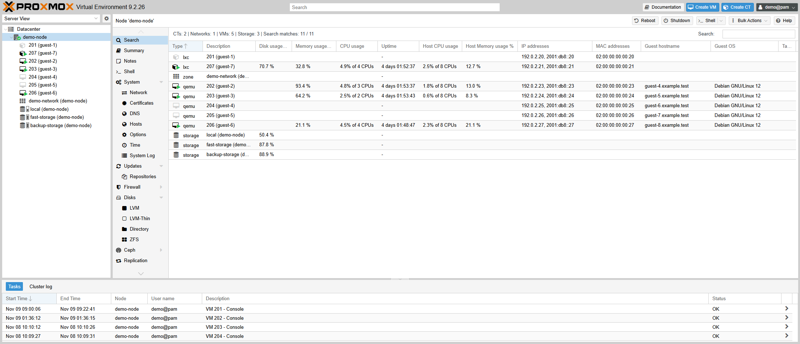

# node_search

Shows guest IP addresses, MAC addresses, hostname and OS in the resource lists and global Search, and makes them searchable.

## Features

- New columns: IP addresses, MAC addresses, guest hostname and guest OS. An optional **Guest information status** column shows where the data came from or why it is missing.
- Both Search views match all of these fields, case-insensitively.
- The IP column sorts numerically (IPv4 before IPv6).
- The resource-list heading shows counts per resource type and **Search matches: shown / all**.

## Configuration

The module has no settings. Enable or disable it with option **[6] Node Search** in `pve-mods-configure`, or set `node_search=1` under `[modules]` in `/etc/pve-mods/pve-mods.conf`. It is disabled by default and independent of the other modules. Reload the browser without cache afterwards.
