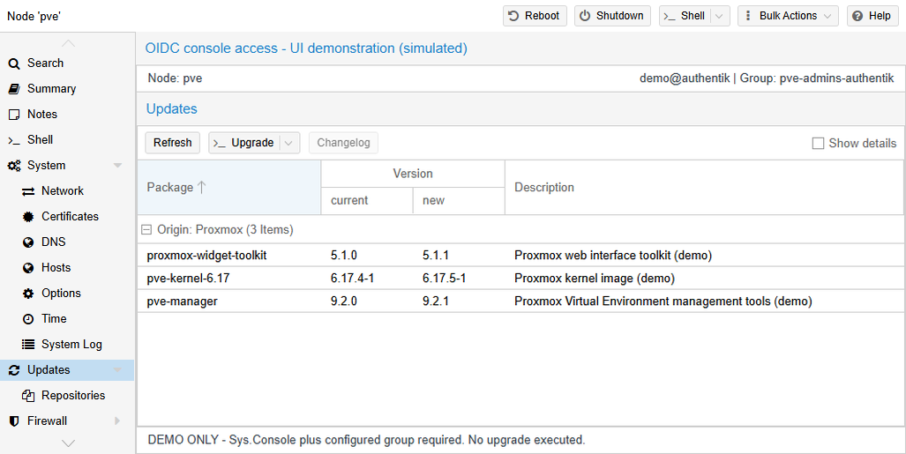
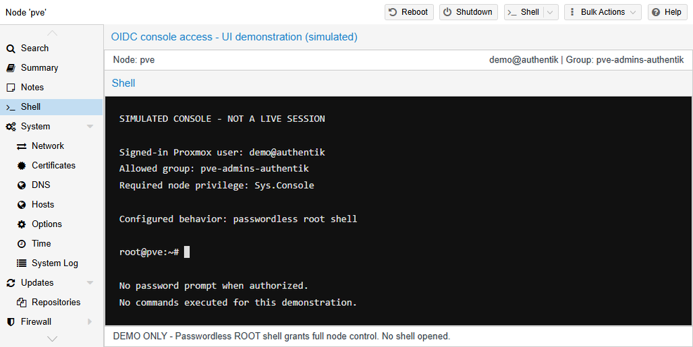

# oidc_console_access

Allows members of selected Proxmox groups to use the node Upgrade console
and/or the passwordless root Shell, which Proxmox normally reserves for
`root@pam`.

## Table of contents

- [Security](#security)
- [Configuration](#configuration)
- [OIDC group synchronization](#oidc-group-synchronization)
- [Required Proxmox permissions](#required-proxmox-permissions)

| Feature | UI location | Setting |
|---|---|---|
| Upgrade console (`pveupgrade --shell`) | Node → Updates → **Upgrade** | `upgrade`, `upgrade_groups` |
| Passwordless root shell | Node → **Shell** | `shell`, `shell_groups` |

Each feature is controlled independently. Members must also have the
`Sys.Console` privilege on `/nodes/<node>`.

<p align="center"></p>

<p align="center"></p>

## Security

- Both features grant root-level access. The Upgrade console can open a root
  shell after running the upgrade; the Shell tab provides a passwordless root
  shell directly.
- Only include users you trust with full control of the node, and keep these
  groups narrowly scoped.
- The checks apply only to enabled, non-expired Proxmox users who belong to a
  configured group. API tokens do not qualify. Other shell commands retain
  Proxmox's normal `root@pam` restriction.
- Setting a feature flag to `0` denies access immediately, even if its patch is
  still installed. Its patch may remain installed until patches are reapplied.

## Configuration

Use the `pve-mods-configure` bash script to choose whether to enable each
feature, then enter the allowed Proxmox groups. Leave a group's field empty to
disable that feature. The module is enabled when at least one feature has a
non-empty group list.

The script stores the settings in
`/etc/pve-mods/conf.d/oidc_console_access.conf`, using this format:

```ini
[access]
upgrade=1
upgrade_groups=pve-admins-authentik
shell=0
shell_groups=
```

The `upgrade` and `shell` flags control whether the matching patches are
applied and are checked on each request. Setting a flag to `0` denies access
immediately, even if its patch is still installed. Its patch may remain
installed until patches are reapplied. The group lists contain comma-separated
Proxmox group names.

An OIDC-synced group name includes the realm suffix. For example, provider
group `pve-admins` synced through realm `authentik` becomes
`pve-admins-authentik`. Use that full Proxmox group name in the configuration.

## OIDC group synchronization

The OIDC realm must receive the user's group names in a groups claim and sync
them into Proxmox. For example, configure the realm to use the `groups` claim
and create Proxmox groups on login:

```sh
pveum realm modify <realm> --groups-claim groups --groups-autocreate 1
```

The claim must contain group names as a JSON array of strings. In Authentik,
the default `profile` scope mapping supplies a `groups` claim; other providers
may require a claim or scope mapping.

To overwrite a user's existing Proxmox group memberships on each login, the
realm can also use `--groups-overwrite 1`. This removes memberships assigned
manually, so leave it off if manual and synced memberships should coexist.

If the identity provider does not supply groups, create a Proxmox group and add
the OIDC user manually:

```sh
pveum group add upgraders
pveum user modify <user>@<realm> --groups upgraders
```

Use the corresponding group name in `upgrade_groups` and/or `shell_groups`.
Do not use this method with `groups-overwrite` enabled, as the manual
membership will be removed at the next login.

## Required Proxmox permissions

This module lifts the `root@pam` restriction; it does not grant Proxmox ACLs.
Give the selected group `Sys.Console` on the node, for example:

```sh
pveum acl modify /nodes/<node> --groups pve-admins-authentik --roles PVEAdmin
```

Use `/` instead of `/nodes/<node>` to apply the ACL to all nodes. The
`Administrator` and `PVEAdmin` roles include `Sys.Console`.
